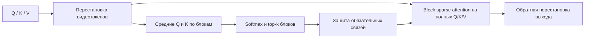
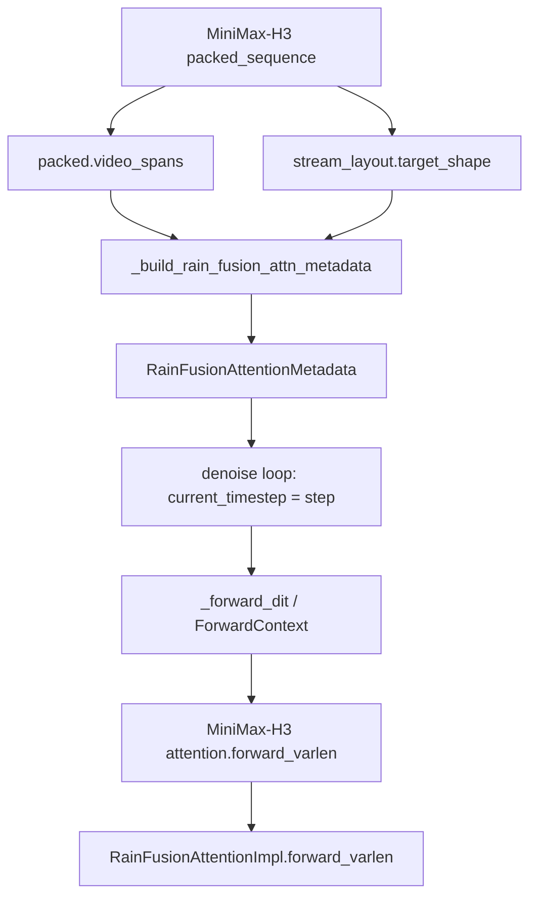

## Что описывает отчёт

Это локальный технический отчёт по состоянию исходников на **21 октября 2026 года**.
Он описывает существующий код после выравнивания TND с RF-v3, включая
незакоммиченные изменения, а не предлагаемую архитектуру. Разделы 5–8 и 14
актуализированы после исправления подготовки и маски RF.

| Источник | Состояние |
| --- | --- |
| SGLang | `/home/amironov/workspace/sglang/fork_xnapkin/sglang`, HEAD `66c0768ec3`, с текущими изменениями RF и packed layout |
| MindIE-SD | `/home/amironov/workspace/mindiesd/MindIE-SD`, HEAD `2f5faeb` |
| Контракт CANN/PTA | Локальная документация `op-plugin` для `npu_block_sparse_attention`; она не подтверждает доступность оператора в любом установленном стеке |

SHA-256 файла `rain_fusion_attn.py` в рассматриваемом состоянии:

```text
25d26b7adef8608cf55633fbb6990a0f4e5bac1f372bced1c27e7afb250bc748
```

Выводы о совпадении ниже относятся к логике исходников. Побитовое совпадение
разных NPU-операторов и производительность на устройстве этим отчётом не установлены.

## 1. Что делает Rain Fusion

Rain Fusion сначала оценивает важность **блоков токенов**, затем запускает attention
только для выбранных пар блоков. Видеоструктура используется при подготовке блоков.



Здесь две разные операции:

1. **Оценка маски:** используются усреднённые Q/K. Это приближённая оценка важности.
2. **Вычисление выхода:** ядро получает полные Q/K/V, а не их средние. Отброшенные
   пары блоков не участвуют в attention, оставшиеся токены участвуют в нормализации.

Поэтому RF — приближённая замена dense attention. Точность умножений внутри
сохранённых блоков не восстанавливает связи, которые маска исключила.

В текущем SGLang Python-бэкенд сам строит перестановку и маску. Он **не вызывает
MindIE-SD**. Sparse-вычисление выполняет `torch.ops.npu.npu_block_sparse_attention`.
Упоминания MindIE-SD ниже означают соответствие алгоритмов и функций, а не зависимость
SGLang от Python-пакета `mindiesd`.

## 2. Форматы данных и два вида блоков

| Обозначение | Значение |
| --- | --- |
| `B` | Число независимых последовательностей в batch |
| `S` | Число токенов одной последовательности |
| `N` | Число attention-голов |
| `D` | Размерность одной головы |
| `total_tokens` | Сумма длин packed-последовательностей |
| `T_video, H_video, W_video` | Временная и пространственные размерности видеосетки в токенах |

| Формат | Форма | Как задаются независимые последовательности |
| --- | --- | --- |
| BSND | `[B, S, N, D]` | Осью `B` |
| BNSD | `[B, N, S, D]` | Осью `B`; это перестановка осей BSND |
| TND | `[total_tokens, N, D]` | Отдельными границами `cu_seqlens` |

Буква `T` в названии TND означает общее количество packed-токенов. Это **не число
видеокадров** из `latent_shape`.

В SGLang используются:

- **Пространственная плитка 8×8:** порядок токенов внутри кадра. В полной плитке
  64 токена.
- **Attention-блок 128×128:** 128 Q-токенов против 128 KV-токенов. Один элемент
  sparse-маски разрешает или запрещает целую такую пару.

Плитка и attention-блок выполняют разные задачи. Неполные плитки и границы кадров
не позволяют в общем случае трактовать каждый attention-блок как две полные плитки.

Для TND, например:

```text
cu_seqlens = [0, 600, 1300]
sequence 0: tokens [0, 600)
sequence 1: tokens [600, 1300)
```

Блоковая маска строится отдельно для каждой последовательности. Непустые spans исполняются одним TND-вызовом с отдельными длинами и масками;
для `None` используется один batched BSND-вызов. Attention между сегментами отсутствует.

## 3. Зачем нужен latent_shape

### Какая именно форма требуется

`latent_shape = [T_video, H_video, W_video]` — сетка **токенов после patchification**.
Это не разрешение выходного видео и не обязательно исходная форма VAE latent.

SGLang builder преобразует последние три размерности `raw_latent_shape`:

```python
latent_shape[i] = raw_latent_shape[-3:][i] // patch_size[i]
```

Например:

```text
raw latent:   [4, 32, 32]
patch size:   [1,  2,  2]
token grid:   [4, 16, 16]
video tokens: 4 * 16 * 16 = 1024
```

Если Q/K/V состоят только из этого видео, их `S` должен соответствовать произведению
размеров сетки. По одному числу `S=1024` нельзя восстановить геометрию: `[4,16,16]`
и `[1,32,32]` имеют одинаковое произведение, но другую структуру кадров.

### На что влияет форма

1. **Перестановка:** код восстанавливает координаты кадра и пространственных плиток.
2. **Pooling:** усредняются уже переставленные группы токенов, поэтому форма меняет
   содержимое pooled-блоков и их оценки важности.
3. **Защита первого кадра:** его длина равна `H_video * W_video`; затронутые блоки
   сохраняются по обеим осям маски.
4. **Обратная перестановка:** возвращает выход к исходному порядку токенов модели.

Самому CANN BSA-ядру `latent_shape` не передаётся. Ядро получает тензоры в готовом
порядке, маску и длины последовательностей. Геометрия нужна Python-подготовке RF.

### Почему одной формы недостаточно для MiniMax-H3

В последовательности могут находиться текст, изображения, несколько видео и аудио.
Форма target video не сообщает, где оно начинается, и ничего не говорит о форме
reference video. Для этого нужен `video_spans`.

## 4. Как строится маска

### Pooling

`_avgpool` SGLang разбивает последовательность на группы по 128 токенов и берёт
среднее по каждой группе. Остаток усредняется по его реальной длине.

```text
S = 300
block 0: tokens [0, 128)   -> mean of 128 tokens
block 1: tokens [128, 256) -> mean of 128 tokens
block 2: tokens [256, 300) -> mean of 44 tokens
```

Хвост не дополняется нулями перед вычислением среднего. Pooled V создаётся в
совместном QKV-пути, но при построении маски используются только pooled Q и K.
Это соответствует подходу `avgpool` / `get_blockwise_mask` MindIE-SD.

### Оценки и top-k

Для каждой головы вычисляется:

```python
scores = query_pool @ key_pool.transpose(-2, -1) * scale
probs = softmax(scores, dim=-1)
keep_len = ceil(num_kv_blocks * (1 - sparsity))
threshold = topk(probs, keep_len).values[..., -1:]
mask = probs >= threshold
```

Форма маски — `[B, N, num_q_blocks, num_kv_blocks]`, тип для ядра — `int8`.
Строка соответствует Q-блоку, столбец — KV-блоку, `1` сохраняет пару.
`scale` берётся из `softmax_scale` бэкенда; автоматически заменять его масштабом
после padding размерности головы нельзя.

### Почему softmax сохранён

В точной арифметике softmax сохраняет порядок значений одной строки. Это объясняет,
почему top-k по logits выглядит эквивалентным. Однако код выбирает по порогу `>=`,
а округление и совпадения значений в низкой точности могут менять маску. В текущем
SGLang и в рассматриваемых mask-функциях MindIE-SD softmax присутствует.

### Почему число единиц превышает keep_len

После top-k код сохраняет обязательные связи:

```text
final_mask = ranked_mask OR protected_query_rows OR protected_kv_columns
```

Для защищённого Q-блока сохраняются **все** KV-блоки его последовательности.
Для защищённого KV-блока сохраняется доступ из **всех** Q-блоков.

Пример для одной незащищённой Q-строки:

```text
KV blocks:                    100
sparsity:                     0.7
top-k budget:                  30
protected KV blocks:           20
protected blocks already top-k: 5
final retained blocks:         30 + 20 - 5 = 45
```

Из-за равных значений на пороге даже исходная `ranked_mask` может содержать больше
`keep_len` единиц. Защищённая Q-строка вообще содержит все 100 единиц.

Так работает и `get_multi_span_blockwise_mask` MindIE-SD: top-k вычисляется по всем
KV-блокам, затем добавляется защита dense-контекста и первых кадров. Значение
`sparsity=0.7` не является обещанием убрать 70% итоговых пар блоков.

Если выбирать top-k только среди видеоблоков либо вычитать protected-блоки из
бюджета, получится другой алгоритм. Полностью выдержать общий бюджет невозможно,
если одних обязательных блоков уже больше этого бюджета.

## 5. BSND-путь SGLang: одно видео

```text
forward
  ├─ current_timestep < skip_first_steps -> dense_attn_impl.forward
  └─ _rain_fusion_sparse_attention
       ├─ _do_tensor_rearrange_pooling
       │    ├─ concatenate Q/K/V along batch
       │    ├─ _rearrange_with_remaining
       │    └─ _avgpool
       ├─ _get_blockwise_mask
       │    └─ _get_blockwise_mask_from_pools
       ├─ _rain_fusion_attention
       │    ├─ _pad_head_dim
       │    ├─ BSND -> BNSD
       │    └─ torch.ops.npu.npu_block_sparse_attention
       └─ _inv_rearrange_with_remaining
```

Это схема legacy-ветки без `video_spans`: `latent_shape` описывает всю
видеопоследовательность. Теперь `forward` также передаёт `video_spans` в общий
RF-helper. Для непустого списка используется multi-span preparation из раздела 8,
для пустого списка — dense attention. Формат входа `forward` именно **BSND**;
BNSD используется у границы CANN-оператора.

Смешанным BSND-последовательностям тоже нужна разметка. Например, в текущих
`flux.py` и `qwen_image.py` имеются joint-attention пути, объединяющие text/image
QKV. Это пример того, почему нельзя считать любой BSND вход чистым видео;
это не подтверждение полной RF/NPU поддержки этих моделей. Универсальный denoising
builder пока не извлекает автоматически spans из каждого такого model layout.
Если выбран RF, разметку должен передать соответствующий вызывающий код.
Без spans длина чистого видео должна соответствовать произведению `latent_shape`.
Отдельной ранней проверки S в текущей копии нет: неверная геометрия может привести
к ошибке reshape либо некорректной интерпретации структуры токенов.

`_do_tensor_rearrange_pooling` объединяет Q/K/V по оси batch, выполняет общую
подготовку и разделяет их обратно через `torch.chunk(..., 3, dim=0)`. Это тот же
способ организации работы, что в legacy-пути MindIE-SD. Он предполагает совместимые
размерности S/N/D; разное число голов не исправляется перестановкой BSND/BNSD.

### Перестановка с остатками

Когда H/W кратны 8, код раскладывает кадры на пространственные плитки. Когда есть
остатки, первый кадр оставляется отдельно, а для остальных кадров сначала идут
полные плитки, затем нижние строки и правые столбцы.

Обратная функция восстанавливает исходную сетку. Это не изменение осей N/S,
а изменение **порядка токенов по S**.

В актуальной рабочей копии сохранён ранний возврат при `T_video=1` или H/W
меньше 8. Для `[1,16,16]` MindIE переставляет row-major сетку в плитки: первая
плитка содержит индексы `0..7, 16..23, ..., 112..119`. SGLang в этом случае
оставляет исходный порядок. Весь единственный кадр защищён, поэтому его маска
полностью dense; это различие порядка и потенциально численного пути, а не
доказательство потери качества от отбрасывания связей.

У MindIE `[2,4,16]` и `[2,16,4]` завершаются ошибкой split, а `[1,17,17]` и
`[1,16,17]` — ошибкой reshape пустой части после первого кадра. SGLang на таких
входах пропускает пространственную перестановку. Следовательно, точное совпадение
подготовки с MindIE относится к общей области: несколько кадров, H/W не меньше
8, включая поддержанные остатки. Ранние возвраты — отдельные расширения SGLang.

## 6. TND-вход: быстрый batched путь и общий packed путь

`forward_varlen` принимает TND Q/K/V и границы последовательностей. RF metadata
он читает из `ForwardContext`. При dense-шаге или отсутствии metadata вызывается
`dense_attn_impl.forward_varlen`.

```text
forward_varlen
  -> _rain_fusion_sparse_attention_varlen
       -> check nonempty segments and max_seqlen
       -> video_spans is None:
            -> same geometry and length for every segment
            -> reshape packed Q/K/V to [B,S,N,D]
            -> _rain_fusion_sparse_attention once for the whole batch
            -> reshape output to TND
       -> explicit video_spans:
            -> rebase spans and prepare each segment
            -> concatenate Q/K/V, pad block masks
            -> one BSA call in TND with actual lengths
            -> restore original token order
```

### Почему старый путь нельзя считать вариантом без batch-цикла

В HEAD `66c0768ec3` функция `_build_varlen_sparse_mask` содержала Python-цикл по
`boundaries`. Внутри отдельно запускались pooling Q/K и mask-helper для каждого
сегмента. Один вызов BSA в TND не означает, что подготовка маски была векторизована.
Кроме того, старая маска не выполняла spatial rearrangement и не защищала первый
кадр. Возможная меньшая стоимость такой версии не является сравнением одной и
той же RF-v3 задачи.

### video_spans=None: один общий batched RF

`None` означает чистое видео с общей `latent_shape`. Все непустые сегменты должны
иметь одинаковую длину, поскольку одна сетка описывает каждый из них. Разные
видеогеометрии следует задавать spans, а не угадывать из одного значения G.

Для границ `[0,512,1024,1536]` вход `[1536,N,D]` представляется как `[3,512,N,D]`.
Общая RF-функция векторизует spatial rearrangement, pooling и построение маски
по batch. BSA вызывается один раз в BNSD, затем выход возвращается в TND.
Цикла tensor-подготовки по видео, списков отдельных Q/K/V и их повторного concat
в этом пути нет. Пустые сегменты длиной 0 не меняют packed-данные.

Это также путь для одного чистого видео: B=1. Он сохраняет защиту первого кадра
и поведение текущей перестановки. Наличие текста/аудио нельзя вывести из None;
такую последовательность нужно размечать явно.

### Явные video_spans: один TND-вызов

При непустой разметке клипы могут иметь разные формы и длины. Каждый сегмент
готовится общей `_prepare_sparse_attention`: перепаковка и выравнивание клипов,
pooling, top-k, защита первых кадров и dense-контекста. Затем Q/K/V собираются в
TND, маски дополняются до максимального числа блоков, и выполняется один BSA.

Для границ `[0,600,1300]` передаются `actual_seq_lengths=[600,700]` и такой же
KV-список. Это длины, а не cumulative offsets. Отдельные masks/lengths не допускают
attention между сегментами. Дополняются маски, не реальные последовательности Q/K/V.

Сегмент без локальных spans получает единичную маску внутри своей реальной длины,
сохраняет исходный порядок и участвует в том же общем BSA. Это относится к `[]`,
audio/text-only сегментам и alignment padding.

### Что можно сказать о времени

Для None новая организация уменьшает число Python-dispatch и отдельных tensor
операций по сравнению с поэлементной подготовкой списка batch. Но это не NPU-замер:
форма batched GEMM, затраты перестановки и версия kernel тоже влияют на время.
Для произвольных spans подготовительный цикл остаётся; один общий BSA не делает
его бесплатным. Численного утверждения «быстрее на X%» здесь нет.

## 7. Что именно означает video_spans

```python
video_spans = [
    {"start": 512, "latent_shape": [4, 16, 16]},
    {"start": 1792, "latent_shape": [6, 16, 16]},
]
```

Первый клип занимает `[512,1536)`, второй — `[1792,3328)`. `start` измеряется
в токенах Q/K/V; формы уже являются token grids. Промежутки вне spans считаются
невидеоконтекстом.

В SGLang TND это **глобальные offsets в packed-тензоре**. При построении маски
конкретного сегмента код вычитает его начало, получая локальный offset.
В MindIE-SD это offsets по S внутри одной эффективной непаддированной последовательности.

Spans не заменяют `cu_seqlens`:

- `cu_seqlens` определяет независимые последовательности, между которыми нет attention.
- `video_spans` определяет видеоклипы внутри последовательности.

Два клипа одной последовательности могут обращаться друг к другу через выбранные
пары блоков. Это не два изолированных attention-вызова.

Builder SGLang проверяет упорядоченность, отсутствие пересечений и положительные
целочисленные размерности. Packed-адаптер дополнительно проверяет, что каждый
span целиком помещается в одном независимом сегменте; span не может пересекать
границу cu_seqlens.
В MindIE-SD `_normalize_video_spans` проверяет span относительно длины входной
эффективной последовательности; адаптер TND должен дополнительно учитывать её сегменты.

## 8. Как video_spans обрабатывает MindIE-SD

### Публичный вход и legacy-режим

```text
mindiesd.sparse_attention(sparse_type="rf_v3")
  -> bsa_sparse_attention_v3
```

Публичный API принимает BSND/BNSD. Число голов задаётся `head_num=...`.
Четвёртый позиционный аргумент — `attn_mask`, поэтому передавать туда число голов нельзя.

Без spans legacy-режим использует `latent_shape_q/k` и `txt_len`: текстовый префикс
отделяется, видеочасть переставляется, текст переносится в конец для pooling и
attention. После вычисления порядок восстанавливается. Mask-helper защищает
последние text-блоки и первый кадр видео.

В коде RF-v3 эти параметры реально используются, хотя отдельные строки docstring
публичной функции описывают их как параметры RF-v2. Имена файлов также не означают,
что все функции из `rf_v2.py` относятся только к запуску ядра второй версии.

### Multi-span-режим

При `video_spans is not None` RF-v3 вызывает:

```text
do_multi_span_tensor_rearrange_pooling
  -> _normalize_video_spans
  -> _multi_span_permutation
       -> _span_rearranged_indices
  -> index_select Q/K/V
  -> avgpool
get_multi_span_blockwise_mask
rain_fusion_attention_v3
inverse index_select
```

В публичном MindIE-SD API `video_spans` взаимоисключается с `txt_len` и
`latent_shape_q/k`. Геометрия берётся из каждого span. Пустой список не означает
«dense-only»: `_normalize_video_spans` требует хотя бы один клип.

### Перепаковка клипов

`_multi_span_permutation` не ограничивается перестановкой внутри исходного span:

1. Выделяет все невидеотокены как dense-контекст.
2. Перемещает клипы в новый общий порядок, переставляя токены каждого клипа.
3. Каждый следующий клип начинает с границы attention-блока.
4. Если хвост предыдущего клипа неполный, заполняет его настоящими dense-токенами.
5. Остальной dense-контекст размещает после клипов.
6. Возвращает inverse-перестановку, `dense_blocks` и `first_frame_blocks`.

Это перенос реальных токенов, а не добавление нулевых padding-токенов. Смешанные
блоки помечаются dense, чтобы все невидеотокены сохраняли полную связность.
Если для выравнивания между клипами не хватает dense-токенов, helper выдаёт ошибку
с указанием перейти на dense attention. Сам публичный вызов не превращает такую
ошибку автоматически в fallback.

Маска использует общий top-k по перепакованной последовательности, затем добавляет
защиту `dense_blocks | first_frame_blocks`. Для multi-span текущая реализация
требует одинаковые размеры Q/KV-блоков; обычный FP8 KV=256 путь не является
полностью span-aware при Q-блоке 128.

### Что совпадает после выравнивания

| Свойство | SGLang BSND и TND-адаптер | MindIE-SD multi-span |
| --- | --- | --- |
| Порядок клипов и контекста | Клипы и dense-контекст перепаковываются | То же |
| Выравнивание начала клипа | Новый attention-блок для каждого клипа | То же |
| Неполный блок перед следующим клипом | Заполняется реальными dense-токенами и защищается | То же |
| Недостаток заполнителей | Ошибка с указанием использовать dense attention | То же по смыслу |
| Top-k | По всем блокам, затем защита | То же |
| Первый кадр каждого клипа | Защищены Q-строки и KV-столбцы | То же |
| Обратная перестановка | По inverse indices | То же |
| Внутреннее хранение protected-блоков | Одно множество `retained` | Два множества `dense_blocks` и `first_frame_blocks`, затем их union |

На общей области поддержанных сеток и при одинаковых параметрах подготовка
no-quant пути совпадает; исключения T=1/малых H/W описаны в разделе 5. Представление объединённого множества protected-блоков не меняет
маску. Отличаются внешний packed API SGLang, dense-only обработка пустых spans,
D padding и зарегистрированная kernel-обёртка. Аппаратная численная идентичность
разных ACLNN-версий из этого не следует.

### Почему txt_len не нужен текущему SGLang

Legacy MindIE `txt_len` описывает специальный layout `[text prefix | single video]`.
Один span `{"start": text_len, "latent_shape": [T,H,W]}` уже описывает тот же
видеодиапазон; все остальные строки являются dense-контекстом. Для аудио между
reference/target видео одного `txt_len` вообще недостаточно, а spans достаточны.

Поэтому поле `txt_len` в SGLang RF не добавлено. Информация о границах видео нужна,
но она передаётся через `video_spans`. Для одного чистого видео остаётся legacy
`latent_shape`, эквивалентный MindIE `txt_len=0`.

Это не утверждение, что старый text-prefix путь и multi-span путь имеют абсолютно
одинаковый порядок при любых входах. Требование совпадения относится к выбранной
ветке MindIE: чистое видео сравнивается с legacy, mixed sequence — с video_spans.

## 9. MiniMax-H3: путь metadata и вычисления

### Формирование разметки

Для t2va/fl2va packed builder создаёт:

```text
[text | conditioning images | target audio | target video | alignment padding]
```

В `video_spans` добавляется target video. Conditioning keyframes являются
изображениями и остаются вне spans.

Для ref2va последовательность содержит reference-блоки в порядке запроса. В
video/video_audio reference-блоках аудио расположено перед соответствующим видео.
Builder добавляет spans для reference video и target video; самостоятельные
reference images и reference audio остаются dense-контекстом.

Один выбранный backend DiT обслуживает **совместную мультимодальную attention**.
Аудиотокены находятся внутри DiT Q/K/V. Поэтому выбор `rain_fusion_attn` для
transformer сам по себе не ограничивает sparsity видеотокенами — нужна разметка.

### Передача в RF



`target_shape` уже задан в токенах. Поэтому H3 helper вызывает RF builder с
`patch_size=(1,1,1)`: повторно делить H/W на patch size модели здесь нельзя.

Helper читает `skip_first_steps` и `sparsity` из конфигурации, по умолчанию 10 и
0.7. RF implementation получает их из metadata текущего forward, не хранит
отдельную копию глобального server config.

В текущем H3 stage сначала вызывается cube metadata builder; если он вернул `None`,
вызывается RF builder. У RF builder есть проверка выбранного transformer backend:
для остальных бэкендов он возвращает `None`. Сам факт вызова helper не означает,
что RF metadata построена для другого backend.

### Где возникает metadata: producer и ForwardContext

H3 выполняет собственный `_run_full_loop`, обходящий обычный
`DenoisingStage._build_attn_metadata`. Поэтому `_build_rain_fusion_attn_metadata`
создаёт объект RF на основе packed layout и конфигурации. `_forward_dit` затем
устанавливает этот объект в `ForwardContext` перед вызовом модели.

`forward_varlen` не обязан принимать metadata аргументом, чтобы её использовать:
он читает `get_forward_context_or_none().attn_metadata`. Контекст — механизм
передачи, не фабрика metadata. Если просто убрать producer, `_forward_dit` получит
None, запишет None в контекст, и DiT останется dense. Сам producer можно встроить
в другую функцию, но его работа сейчас не дублируется общим H3 builder.

### Refiner и text encoder — разные компоненты

В canonical H3 pipeline `_precompute_refined_prompt_embeds` вызывается **до**
цикла denoising и `_forward_dit`. Refiner в этом пути обычно видит отсутствие
ForwardContext или `attn_metadata=None`; RF и без проверки prefix выбрал бы dense.

Но модель поддерживает второй путь: `_embed` вызывает `refine_prompt_embeds`,
если `refined_prompt_embeds_length` не передан. Это происходит внутри model forward,
который уже может исполняться под DiT-контекстом. `refine_prompt_embeds` сам контекст
не очищает. Поэтому отсутствие metadata для refiner не является универсальной
гарантией всех поддержанных вызовов модели.

`_is_text_refiner` защищает именно fallback: joint DiT spans не относятся к
отдельной текстовой последовательности. Он сохраняет conditioning refiner dense.
Сам низкоуровневый BSA не запрещает текст; видеогеометрия RF к этому тексту неприменима.

Не следует смешивать два случая:

- `attn_metadata is None` — нет RF metadata, используется dense attention;
- `attn_metadata.video_spans is None` при существующей RF metadata — single-video
  режим RF по latent_shape. Это не отсутствие metadata.

Отдельный text encoder по умолчанию получает `torch_sdpa`, когда глобально выбран
laser/rain и нет явного component/role override для text encoder. Это отдельная
настройка и не управление встроенным token_refiner внутри DiT.

### Padding не является видео или аудиоконтекстом

H3 задаёт границы вида `[0, used, total]`: реальные токены и отдельный хвост для
выравнивания. Текущий RF обрабатывает хвост как отдельный сегмент без video spans, с полностью
сохранённой маской внутри того же TND BSA-вызова. Хвост не становится KV-контекстом
реальных токенов. Вычисления для него не пропускаются, выход не обнуляется специально.

Флаг `packed_trailing_padding=True`, передаваемый моделью backend implementation,
в RF отдельно не обрабатывается. Он может быть передан дальше dense implementation,
но это не равнозначно обработке флага sparse-путём RF.

### Что означает dense для аудио

При корректных spans все блоки, содержащие аудио, защищены по Q и KV. В одном
attention-вызове аудио-Q сохраняют доступ ко всем реальным KV своего сегмента;
видео-Q сохраняют доступ к аудио-KV.

Это не обещает побитово одинаковое итоговое аудио относительно полностью dense
модели: приближённые video states влияют на следующие слои совместной модели,
а численная реализация разных ядер тоже может отличаться.

## 10. Соответствие функций SGLang и MindIE-SD

Обозначение `v2` ниже означает файл `sparse_flash_attn_rf_v2.py`, а `v3` —
`sparse_flash_attn_rf_v3.py`. RF-v3 импортирует часть подготовки из файла v2.

| SGLang | MindIE-SD | Что совпадает и что отличается |
| --- | --- | --- |
| `RainFusionAttentionBackend` | Прямого аналога нет | SGLang registry, supported head sizes, выбор implementation/metadata |
| `RainFusionAttentionMetadataBuilder.build` | Аргументы `sparse_attention` и проверки spans | SGLang формирует per-forward объект и конвертирует raw latent в token grid; MindIE получает параметры вызова |
| `forward` | `sparse_attention` → `bsa_sparse_attention_v3` | Оркестрация, но в SGLang есть расписание dense-шагов; возможности layout и квантования отличаются |
| `_avgpool` | v2 `avgpool` | Одинаковое среднее полных и хвостового блоков на общих входах; SGLang поддерживает внутренний BSND, MindIE ещё BNSD; пустой вход обработан по-разному |
| `_get_blockwise_mask` | v2 `get_blockwise_mask` | Разделение pooled QKV и передача на mask-helper; в SGLang нет legacy txt_len ветки |
| `_get_blockwise_mask_from_pools` | v2 `get_blockwise_mask` | Matmul вместо einsum выражает ту же оценку для совместимых голов; softmax/top-k/порог и защита первого кадра совпадают по смыслу |
| `_rearrange_with_remaining` | v2 `rearrange_with_remaining` | Reshape/permute вместо einops; совпадает на общей области нескольких кадров с H/W не меньше 8; ранние возвраты SGLang остаются отличием |
| `_inv_rearrange_with_remaining` | v3 `_bsa_inv_rearrange`, также v2 inverse helpers | Обратное преобразование для выбранного порядка; отличается поддержкой BNSD и специальными случаями |
| `_do_tensor_rearrange_pooling` | v2 `do_tensor_rearrange_pooling` | Совпадает общий QKV concat → rearrange → pool → chunk при txt_len=0; переноса text-префикса в SGLang нет |
| `_pad_head_dim` | Прямого аналога в общем BF16 RF-пути нет | SGLang дополняет D=32 до 64, D=96 до 128, затем обрезает выход; MindIE имеет другие padding-операции в quantized-путях |
| `_rain_fusion_attention` | v3 `rain_fusion_attention_v3` | Похожая BF16 kernel-обёртка, BSND → BNSD и обратно; разные зарегистрированные операторы и набор режимов |
| `_rain_fusion_sparse_attention` | v3 `bsa_sparse_attention_v3` | Общий legacy/multi-span no-quant pipeline; в SGLang нет txt_len, cached_mask и quantization |
| `forward_varlen` | Прямого публичного TND аналога RF-v3 нет | SGLang интерпретирует cu_seqlens и ForwardContext; публичный MindIE RF-v3 принимает BSND/BNSD |
| `_do_multi_span_tensor_rearrange_pooling` | v2 `do_multi_span_tensor_rearrange_pooling` | Одинаковая перестановка Q/K/V, pooling и inverse; SGLang сразу объединяет множества защищённых блоков |
| `_video_span_permutation` | v2 `_span_rearranged_indices` и `_multi_span_permutation` | То же выравнивание и порядок; dense-индексы собираются из диапазонов вместо boolean selection |
| `_rain_fusion_sparse_attention_varlen` | Прямого аналога нет | Для None — прямой batched BSND RF; для явных spans — общая подготовка сегментов и один TND BSA; отдельного mask-алгоритма нет |

Функции MindIE `get_mask_index` и возврат `select_idx/select_num_idx` обслуживают
другой интерфейс sparse-ядра, используемый RF-v2. SGLang RF передаёт бинарную маску
в BSA, поэтому такой конвертер индексов ему не требуется.

## 11. Ядра, precision и ограничения форм

### Какая часть является только форматом

Преобразование BSND ↔ BNSD само по себе меняет оси, а не attention-граф.
При правильной передаче маски и обратной перестановке это представление одной задачи.
Переход к TND также может представлять ту же задачу, если сохранены границы,
порядок токенов, маска и реальные длины. Сам формат этого не гарантирует.

В обновлённом коде TND использует ту же подготовку, что BSND. Для чистого видео
сравнивается legacy-ветка MindIE, для смешанной последовательности — multi-span.
Это выравнивает алгоритм; остаются различия API, организации запусков и ядра.

### Какое ядро запускается

| Путь | Оператор |
| --- | --- |
| SGLang sparse RF | `torch.ops.npu.npu_block_sparse_attention` |
| MindIE-SD RF-v3 no-quant | `torch.ops.mindiesd.block_sparse_attention` |

MindIE C++ plugin проверяет наличие ACLNN V3/V2 и использует доступный путь с
legacy fallback. Совпадающие Python-аргументы не доказывают, что в разных сборках
запускается одна версия ACLNN. Название RF-v3 также не является обещанием всегда
использовать именно `aclnnBlockSparseAttentionV3`.

SGLang выбирает dense implementation по чипу: для Ascend 950 — `AscendFA`, для
910 — `LaserAttention`. `inner_precise` устанавливается в 4 для 950 и 0 для 910.
Доступность этих путей зависит от реальных torch_npu/CANN/sgl-kernel-npu сборок.

MindIE-SD RF-v3 также содержит `mix`, `fp8`, `mxfp4`, Hadamard rotations,
quant/dequant scales и возможность `cached_mask`. Их нет в текущем SGLang RF.
Сравнивать этот SGLang следует прежде всего с no-quant веткой, при одинаковых scale,
precision-параметрах и геометрии. Дефолты тоже нужно выровнять явно:

| Точка входа | Sparsity по умолчанию | Inner precise по умолчанию |
| --- | --- | --- |
| SGLang H3 metadata helper | 0.7 | RF implementation выбирает 4/0 по чипу |
| MindIE `sparse_attention` | 0.0 | 0; для RF-v3 на A5 публичный API требует 4 |
| MindIE `bsa_sparse_attention_v3` | 0.5 | 4 |

Дефолт внутреннего helper не применяется, если публичный wrapper явно передал
свой аргумент. Поэтому публичный вызов RF-v3 без `sparsity` не означает sparse 0.5.

### Почему поддержка ядра не равна поддержке RF

В документации локального CANN/PTA BSA-контракта разрешены разные Q/KV lengths и
числа голов при `Nq >= Nkv`, `Nq % Nkv == 0`. Однако RF должен ещё построить маску:

- BSND QKV concat требует совместимых S/N/D и не реализует general GQA grouping.
- TND использует общие границы и требует одинаковое число Q/KV токенов.
- Все sparse-пути теперь проходят общую QKV-подготовку; general GQA grouping в
  ней не реализован. Например, Nq=8/Nkv=2 не становится поддержанным от правильного
  `num_key_value_heads`. Предыдущее случайное broadcasting Nkv=1 в старом TND
  mask-helper не является основанием заявлять поддержку MQA нового полного пути.
- D у Q и K должен совпадать для pooled dot product; имеющаяся TND проверка
  `query.shape[0] != key.shape[0] or key.shape != value.shape` этого не гарантирует.

GQA — отношение **числа голов**, а не условие делимости длин последовательностей.
Неравенство Sq/Sk само по себе не доказывает cross-attention. В SGLang выбор dense
для cross-attention опирается на роль `is_cross_attention`; полный RF-путь рассматривает
self-attention, даже если низкоуровневое ядро допускает более общие входы.

Конструктор RF отвергает causal attention. BSA вызывается с `softmax_lse_flag=0`;
этот путь не предоставляет LSE для ring-attention merge. MiniMax-H3 отдельно
ограничивает ring-параллелизм FlashAttention backend.

## 12. Как geometry и spans влияют на время и качество

| Механизм | Возможное влияние на время | Влияние на вычисление |
| --- | --- | --- |
| Пространственная перестановка | Перенос данных и индексы добавляют работу | Меняет состав pooled-блоков и маску |
| Pooling и top-k | Дополнительные операции; pooled score matrix всё ещё плотная | Приближённый выбор важных пар блоков |
| Защита аудио/текста/изображений | Увеличивает число сохраняемых пар | Сохраняет их полную связность внутри слоя |
| Первый кадр каждого видео | Дополнительные dense строки и столбцы | Сохраняет видеоякоря каждого клипа |
| Выравнивание multi-span packing | Требует перемещения dense-токенов и защиты смешанных блоков | SGLang и MindIE теперь используют одинаковое правило |
| Переход dense → sparse по шагам | Уменьшает число sparse-шагов | Меняет этапы denoising, на которых используется приближение |
| D padding | Увеличивает размер вычисления | Нули сохраняют исходные dot products при неизменном scale; возможны различия численного пути ядра |

Скорость зависит от числа фактически сохранённых блоков, длины dense-контекста,
количества клипов, выравнивания, dtype и версии ядра. Число `1 / (1 - sparsity)`
не является оценкой end-to-end ускорения. При большом аудио/text-контексте защита
может оставить почти плотную маску, а подготовка RF всё равно выполняется.

## 13. Где читать исходники

Основные файлы SGLang:

- [rain_fusion_attn.py](/home/amironov/workspace/sglang/fork_xnapkin/sglang/python/sglang/multimodal_gen/runtime/layers/attention/backends/rain_fusion_attn.py) — backend, metadata, pooling, masks, перестановки, BSA-вызовы.
- [H3 packed_sequence.py](/home/amironov/workspace/sglang/fork_xnapkin/sglang/python/sglang/multimodal_gen/runtime/pipelines_core/stages/model_specific_stages/minimax_h3/packed_sequence.py) — реальные смещения reference/target video и audio.
- [H3 stages/denoising.py](/home/amironov/workspace/sglang/fork_xnapkin/sglang/python/sglang/multimodal_gen/runtime/pipelines_core/stages/model_specific_stages/minimax_h3/stages/denoising.py) — создание RF metadata и ForwardContext.
- [H3 denoise_loop.py](/home/amironov/workspace/sglang/fork_xnapkin/sglang/python/sglang/multimodal_gen/runtime/pipelines_core/stages/model_specific_stages/minimax_h3/denoise_loop.py) — per-step current_timestep.
- [minimax_h3.py](/home/amironov/workspace/sglang/fork_xnapkin/sglang/python/sglang/multimodal_gen/runtime/models/dits/minimax_h3.py) — refiner, attention dispatch, cu_seqlens и ring-ограничения.

Основные файлы MindIE-SD:

- [sparse_flash_attn.py](/home/amironov/workspace/mindiesd/MindIE-SD/mindiesd/layers/flash_attn/sparse_flash_attn.py) — публичный `sparse_attention` и dispatch RF-v2/v3.
- [sparse_flash_attn_rf_v2.py](/home/amironov/workspace/mindiesd/MindIE-SD/mindiesd/layers/flash_attn/sparse_flash_attn_rf_v2.py) — общие pooling/rearrangement/mask и multi-span helpers, используемые также RF-v3.
- [sparse_flash_attn_rf_v3.py](/home/amironov/workspace/mindiesd/MindIE-SD/mindiesd/layers/flash_attn/sparse_flash_attn_rf_v3.py) — orchestrator RF-v3, quantized-пути и kernel wrapper.
- [block_sparse_attention.cpp](/home/amironov/workspace/mindiesd/MindIE-SD/csrc/plugin/block_sparse_attention.cpp) — выбор ACLNN-версии.
- [локальный контракт torch_npu BSA](/home/amironov/workspace/agent/op-plugin/docs/zh/custom_APIs/torch_npu/torch_npu-npu_block_sparse_attention.md) — layouts, длины, головы и размерности оператора.


## 14. Проверки текущей ревизии

Локальная CPU-проверка выполнена на реальных функциях RF и ForwardContext с
подменой аппаратного BSA на CPU SDPA и изоляцией package startup. Проверены:

- три чистых видео с `video_spans=None`, включая пустую границу cu_seqlens:
  один BNSD-вызов с batch=3, точное совпадение mask/output с независимыми вызовами;
- сохранение общего TND-вызова для двух размеченных видео разных длин и dense-хвоста;
- исполнение настоящего `_precompute_refined_prompt_embeds` без активного контекста;
- передача созданной RF metadata через настоящий `_forward_dit`;
- отсутствие RF metadata в DiT, если producer не создал объект;
- наследование активной DiT metadata настоящим `refine_prompt_embeds`, вызванным
  из-под такого контекста, как в model fallback.

Ранее, до восстановления специальных возвратов T=1/малых H/W, выполнялись
30 сравнений с Python-функциями MindIE-SD: 21 legacy и 9 multi-span случаев.
Это историческая проверка общей подготовки, не аппаратная проверка текущей ревизии.

В локальном окружении стандартный импорт пакета ограничен отсутствующими
зависимостями startup; обходились только обнаружение платформы и package init.
Новая проверка не измеряет NPU latency, качество генерации или графовый режим.

## 15. Контракты функций: вход → преобразование → выход

Обозначения: `G=[T_video,H_video,W_video]`, `L` — число токенов сегмента,
`M=ceil(L/128)`, `K` — число непустых packed-сегментов, `Mmax` — максимальное
число блоков сегмента. Все BSND-входы здесь имеют форму `[B,L,N,D]`, TND —
`[total_tokens,N,D]`. `inverse[i]` указывает, откуда взять результат для исходного
токена i после перестановки.

### 15.1 Регистрация и metadata SGLang

| Функция | На входе | Что делает | На выходе |
| --- | --- | --- | --- |
| `RainFusionAttentionBackend.get_supported_head_sizes` | Нет аргументов | Объявляет поддерживаемые размеры головы бэкенда | `[32,64,96,128]`; D=32/96 далее дополняются до контрактного размера BSA |
| `RainFusionAttentionBackend.get_enum` | Нет аргументов | Возвращает идентификатор для selector/dispatch | `AttentionBackendEnum.RAIN_FUSION_ATTN` |
| `RainFusionAttentionBackend.get_impl_cls` | Нет аргументов | Связывает registry с реализацией | Класс `RainFusionAttentionImpl`, не экземпляр |
| `RainFusionAttentionBackend.get_metadata_cls` | Нет аргументов | Объявляет тип runtime metadata | Класс `RainFusionAttentionMetadata` |
| `RainFusionAttentionBackend.get_builder_cls` | Нет аргументов | Объявляет builder metadata | Класс `RainFusionAttentionMetadataBuilder` |
| `RainFusionAttentionMetadataBuilder.build` | Номер шага, skip, sparsity, raw latent shape, patch size, optional spans | Проверяет параметры и spans; делит raw grid на patch size; сохраняет разметку без повторного patchification spans | Объект metadata: шаг, skip, sparsity, token-grid `latent_shape`, `video_spans` |
| `RainFusionAttentionImpl.__init__` | Число голов, D, causal, scale, optional KV heads, prefix и backend args | Отвергает causal; выбирает dense implementation и precision по чипу; задаёт блок 128 и плитку 8; определяет text refiner | Экземпляр с готовой конфигурацией; attention ещё не вычисляется |

`video_spans=None` в builder является значением по умолчанию, а не пустым списком.
Builder не способен найти текст/аудио по самим Q/K/V: вызывающий код должен знать
структуру последовательности.

### 15.2 Подготовка данных и маски SGLang

| Функция | На входе | Что делает | На выходе |
| --- | --- | --- | --- |
| `_avgpool` | BSND-тензор и pool size | Усредняет полные блоки; остаток усредняет по реальному числу токенов | `[B,M,N,D]`; для объединённого QKV ось batch равна `3B` |
| `_get_blockwise_mask` | Pooled QKV `[3B,M,N,D]`, sparsity, scale, block size, G | Делит pooled QKV на Q/K/V и вызывает mask-helper | `int8` маска `[B,N,M,M]` |
| `_get_blockwise_mask_from_pools` | Pooled Q/K, sparsity, scale, block size, optional G | Dot product → softmax → порог top-k; при G защищает первый кадр по Q и KV | Бинарная `int8` маска, `1` означает разрешённую пару блоков |
| `_rearrange_with_remaining` | BSND-тензор и G | Собирает spatial tiles; раскладывает остатки, при необходимости отдельно первый кадр; имеет специальные ранние возвраты | Тензор той же формы, но с выбранным порядком S |
| `_inv_rearrange_with_remaining` | Выход в spatial-tile порядке и G | Обратное преобразование reshape/permute и хвостов | BSND-тензор в исходном порядке токенов |
| `_do_tensor_rearrange_pooling` | BSND Q/K/V одинаковой геометрии, block size, G | Объединяет QKV по batch, переставляет, усредняет и разделяет Q/K/V | `(q,k,v,qkv_pool)`; первые три той же формы, pool `[3B,M,N,D]` |
| `_video_span_permutation` | BSND query для длины/device и непустые spans | Собирает индексы клипов и dense-контекста; выравнивает клипы; вычисляет обратные индексы и protected-блоки | `(permutation,inverse,retained)`; два индексных тензора `[L]` и множество номеров блоков |
| `_do_multi_span_tensor_rearrange_pooling` | BSND Q/K/V равной формы и spans | Применяет одну index permutation к QKV, выполняет pooling | `(q,k,v,qkv_pool,inverse,retained)` |
| `_prepare_sparse_attention` | BSND Q/K/V, G, sparsity, `None`/list spans | Общая подготовка для обоих layouts: legacy rearrange + первый кадр, либо multi-span packing + protection; `[]` даёт исходные данные и full mask | `(q,k,v,mask,inverse)`; inverse задан для multi-span, иначе `None` |
| `_pad_head_dim` | Q/K/V в BSND или TND | Дополняет только D нулями: 32→64, 96→128; D=64/128 оставляет | Три тензора с D=64/128; исходный scale не пересчитывается |

`retained` объединяет блоки dense-контекста и первых кадров. Его добавление
после top-k может увеличить число единиц маски. В `_prepare_sparse_attention([])`
полностью сохраняются все реальные блоки; padding маски до `Mmax` выполняется позже.

### 15.3 Оркестрация и исполнение SGLang

| Функция | На входе | Что делает | На выходе |
| --- | --- | --- | --- |
| `_rain_fusion_attention` | Подготовленные BSND Q/K/V и готовая block-mask | Дополняет D, переводит BSND→BNSD, вызывает BSA, обрезает D и возвращает оси | BSND attention output `[B,L,N,D_original]` в подготовленном порядке S |
| `_rain_fusion_sparse_attention` | BSND Q/K/V, G, sparsity, spans | Для `[]` вызывает dense implementation; иначе общая подготовка → BSA → inverse | BSND output в исходном порядке; `video_spans=None` использует G |
| `forward` | BSND Q/K/V и RF metadata | Выбирает dense по номеру шага или передаёт геометрию/маску в sparse pipeline | BSND output; принятие BNSD относится к нижней kernel-границе, не к этому API |
| `_rain_fusion_sparse_attention_varlen` | TND Q/K/V, boundaries, max length, sparsity, G, глобальные spans | Для None группирует равные видео через reshape и сразу вызывает общий RF; для spans готовит сегменты и делает один TND BSA | TND output `[total_tokens,N,D_original]` в исходном packed-порядке |
| `forward_varlen` | TND Q/K/V, `cu_seqlens`, max length, optional host boundaries | Проверяет границы; читает ForwardContext; выбирает dense для ранних шагов/отсутствия metadata/refiner, иначе packed sparse pipeline | TND output той же token/head размерности |

Для explicit-spans TND kernel-входов маска имеет форму `[K,N,Mmax,Mmax]`, а
`actual_seq_lengths` — список из K длин, не cumulative offsets. Q/K/V не
дополняются до одинаковой S: они остаются packed. Дополняются **маски**, и только
по блочным осям. D padding является отдельной операцией.

Восстановление результата требует знания layout каждого сегмента:

- `inverse` задан: выполнить `index_select` по token axis;
- spans равен `None`: вызвать legacy inverse по G;
- spans равен `[]`: порядок уже исходный, spatial inverse не применяется.

### 15.4 Роль model-specific helpers MiniMax-H3

| Функция | На входе | Что делает | На выходе |
| --- | --- | --- | --- |
| `minimax_h3_packed_sequence` | Длина текста, размеры target video/audio, keyframe-параметры | Строит токенные диапазоны, позиционные сетки и padded packed layout; добавляет span target video | `packed` dict с `video_spans`, `cu_seqlens`, `stream_layout` и токенными полями |
| `minimax_h3_packed_sequence_ref2va_blocks` | Те же target-параметры и ordered reference blocks | Раскладывает reference image/audio/video и target; собирает spans только reference/target video | `packed` dict; изображения и аудио остаются вне video spans |
| `_build_rain_fusion_attn_metadata` | Server args и готовый H3 packed layout | Проверяет выбранный transformer backend; для RF передаёт уже patchified shapes/spans в builder | RF metadata либо `None` для другого backend |
| H3 `_forward_dit` | Модель, model kwargs, step, batch, metadata | Устанавливает step ForwardContext, затем вызывает модель/graph runner | Выходы video/audio модели; RF читает metadata из этого контекста |

### 15.5 Соответствующие функции MindIE-SD

Эти функции находятся в другом репозитории. Существующий SGLang backend их не
импортирует и не вызывает.

| Функция MindIE-SD | На входе | Что делает | На выходе |
| --- | --- | --- | --- |
| `sparse_attention` | BSND/BNSD Q/K/V, тип sparse, геометрия или spans, параметры precision | Проверяет API, dispatch в RF-v2/v3 либо dense | Attention output в исходном layout |
| `avgpool` | BSND/BNSD тензор и block size | Среднее по полным и последнему неполному блоку | Pooled-тензор с той же организацией batch/head осей |
| `do_tensor_rearrange_pooling` | Q/K/V, txt_len, geometry, pool size, layout | Переносит text prefix в хвост, переставляет видео и усредняет QKV | Переставленные Q/K/V и общий pooled QKV |
| `rearrange_with_remaining` | BSND/BNSD тензор и geometry | Spatial-tile permutation с остатками | Тензор той же формы в новом S-порядке |
| `_bsa_inv_rearrange` / `inv_rearrange_with_remaining` | Подготовленный output и geometry | Обратная spatial перестановка | Output в исходном видеопорядке |
| `do_tensor_inv_rearrange` | Output, txt_len, geometry, layout | Восстанавливает video order и возвращает text из хвоста в префикс | Исходный mixed text/video порядок |
| `get_blockwise_mask` | Pooled QKV, txt_len, sparsity, scale, geometry | Softmax/top-k и защита text/первого кадра | При `return_binary=True` int8 mask; иначе представление select indices/counts для RF-v2 |
| `get_mask_index` | Бинарная block-mask | Вычисляет индексы выбираемых KV-блоков для index-based интерфейса | Упорядоченное индексное представление маски |
| `_normalize_video_spans` | Descriptors и реальная длина S | Нормализует start/shape в целые числа; проверяет диапазоны | Список `(start,shape,length)`; пустой список отвергается |
| `_span_rearranged_indices` | Start, shape, layout, device | Применяет video permutation к индексам одного клипа | Индексный тензор длиной `T_video*H_video*W_video` |
| `_multi_span_permutation` | Нормализованные spans, S, block size, layout, device | Перепаковывает клипы, использует dense filler и отмечает protected blocks | `(permutation,inverse,dense_blocks,first_frame_blocks)` |
| `do_multi_span_tensor_rearrange_pooling` | Q/K/V и spans | Проверяет длины, строит permutation, переставляет и усредняет QKV | `(q,k,v,qkv_pool,inverse,dense_blocks,first_frame_blocks)` |
| `get_multi_span_blockwise_mask` | Pooled QKV, sparsity, scale и protected sets | Общий top-k плюс union protection | Int8 mask для BSA либо index/count представление RF-v2 |
| `rain_fusion_attention_v3` | Подготовленные Q/K/V, mask, lengths, layouts, precision-related args | Приводит формат и вызывает `torch.ops.mindiesd.block_sparse_attention` | Attention output в согласованном с вызывающим кодом layout |
| `bsa_sparse_attention_v3` | Исходные Q/K/V, geometry или spans, sparsity, optional cached mask, precision | Полный RF-v3 pipeline: подготовка, маска/кеш, optional quantization, kernel, inverse | `(output,new_mask)` |

Quantization helpers MindIE (`_eagle_qbsa_quant_qkv`, `_fp8_quant_qkv`,
`_mxfp4_quant_qkv`) готовят Q/K/V и quant scales для других режимов ядра.
`_adapt_mask_for_block_sizes` согласует маску с различными размерами Q/KV блоков,
а `_generate_mask_direct` строит её при разной granularity pooling. Они не
участвуют в сравниваемой no-quant ветке SGLang с блоками 128×128.
